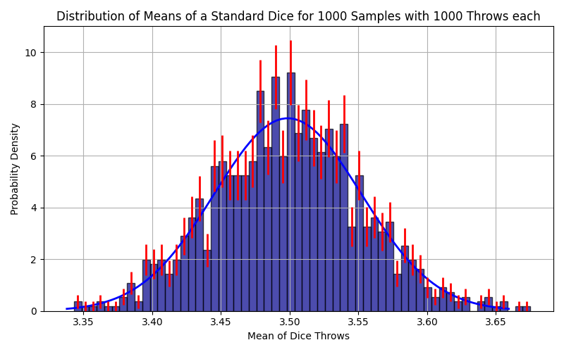

# Histogramm mit Fehlerabschätzung

## Einleitung

In dieser Aufgabe beschäftigen wir uns mit der Visualisierung und statistischen Analyse von Stichprobenmittelwerten eines fairen Würfels. Ziel ist es, ein besseres Verständnis für die Gauß-Verteilung und die damit verbundenen Unsicherheiten zu entwickeln. Dazu werden wir mehrere Python-Funktionen implementieren, die die Berechnung der Gauß-Verteilung, die Erzeugung von Stichprobenmittelwerten sowie die Unsicherheitsabschätzung für die resultierenden Histogramme ermöglichen.

### Gauß-Verteilung

Die Gauß-Verteilung ist gegeben durch:

  $$
  f(x) = \frac{1}{\sigma \sqrt{2\pi}} \exp{\left({-\frac{1}{2} \left(\frac{x - \mu}{\sigma}\right)^2}\right)}
  $$

Dabei ist $\mu$ der Mittelwert und $\sigma$ die Standardabweichung.


## Aufgaben

1. **Helper-file**
    - Erstelle ein Python-file mit dem Namen `helpers.py`. Füge in dieses alle Funktionen ein, die du verwendest.
    - Importiere dann die Funktionen in das Python-script `histogram.py`.
    ```python
    from helpers import func1, func2, func3
    ```

2. **Gauß-Verteilung**
    - Implementiere die Funktion `calc_gauss`, welche die Gauß-Verteilung mit den Parametern `mu` (Mittelwert) und `sigma` (Standardabweichung) berechnet. 
3. **Erzeugung von Stichprobenmittelwerten**
    - Implementiere die Funktion `get_dice_mean`. Diese soll die Stichprobenmittelwerte eines fairen Würfels als Liste zurückgeben (`N` Stichproben zu jeweils `N_throws` Würfen).
    ```python
    def get_dice_mean(N, N_throws = 10000):
        """
    calculate the mean of N_throws of dice throws for N samples

    Parameters:
    N : int
        Number of samples generated.

    N_throws : int
        Number of dice throws per sample. Default is 10000.
    
    Returns:
        List of means of N_throws of dice throws for N samples.
    """
    ```

5. **Unsicherheitsabschätzung**
    - Implementiere die Funktion `calc_frequentist_uncertainty`, welche die Höhe der Bins, deren Unsicherheit und deren Zentrum zurückgibt.
    ```python
    def calc_frequentist_uncertainty(sample_means, N_bins):
    """
    Calculate the frequentist uncertainty of the sample means.

    Parameters:
        sample_means : List of sample means.
        N_bins : Number of bins for the histogram.

    Returns:
        h_i: array with heights of the bins
        sig_h_i: array with uncertainties of the heights of the bins
        bin_centers: array with centers of the bins
    """
    ```
    - Nutze dafür `np.histogram` und die Formeln für ein normiertes Histogramm
    $$
      h_i = \frac{N_i}{N b_i}
    $$

    $$
      \sigma_{h_i} = \frac{1}{b_i N} \sqrt{N_i (1 - \frac{N_i}{N})},
    $$
    wobei $N_i$ die Anzahl an Werten in Bin $i$ ist und $b_i$ die Breite von Bin $i$ (für uns haben alle Bins die gleiche Breite).
1. **Visualisierung**
    - Visualisiere nun die Ergebnisse in `histogram` in Form eines (Überraschung) Histogramms. Setze dafür den Parameter `density` in der Funktion `matplotlib.pyplot.hist` auf `True`, um die Wahrscheinlichkeitsdichte zu erhalten.
    - Erstelle die zu deinen Stichprobenmittelwerten korrespondierende Gauß-Verteilung.
    - Erstelle Errorbars mittels `calc_frequentist_uncertainty`.
    - Beschrifte die Graphik.

2. **Überlegungen**
    - Ändere die Parameter `N`, `N_throws` und `bins`. Welche Schlüsse ziehst du daraus?
    - Welche Schwachstelle hat unsere Fehlerabschätzung?

## Hinweise

* Referenzplot:

<div align="center">

</div>
