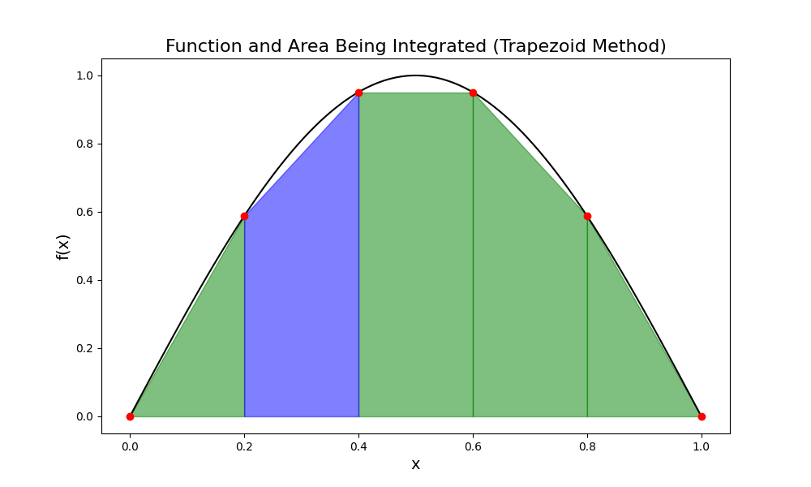
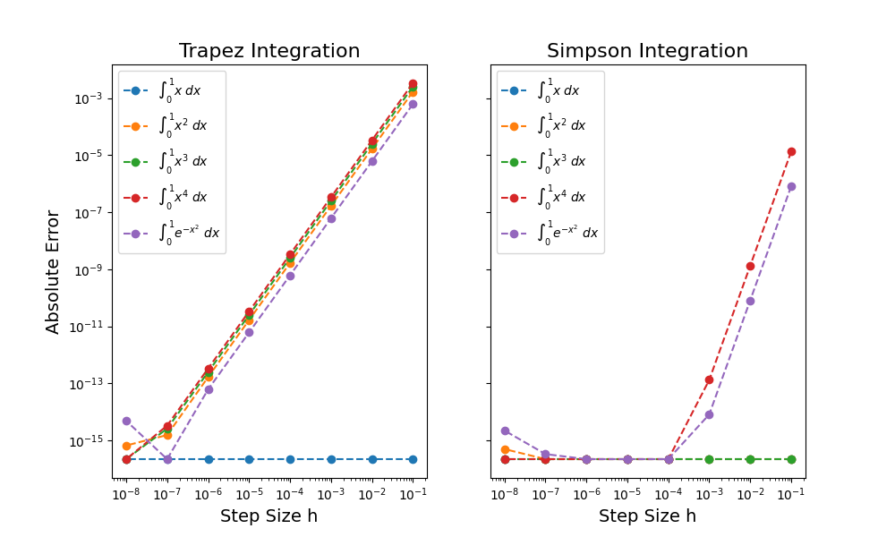

[ValueError]: https://docs.python.org/3/library/exceptions.html#ValueError
[erf]: https://docs.scipy.org/doc/scipy/reference/generated/scipy.special.erf.html
[epsilon]: https://numpy.org/doc/stable/reference/generated/numpy.finfo.html
[np.sum]: https://numpy.org/doc/stable/reference/generated/numpy.sum.html
# Numerische Integration

## Einleitung

Um numerisch zu integrieren, teilen wir unser Integral in mehrere kleinere Integrale auf. Unsere erste Integrationsmethode ist die simple Trapezmethode. Dabei konzentrieren wir uns zuerst nur auf das Teilintegral in Blau, siehe Skizze. Dieses können wir allgemein als $\int_{x_i}^{x_{i + 1}} f(x) \, dx$ schreiben und approximieren es als

$$
\int_{x_i}^{x_{i + 1}} f(x) \, dx \approx f_{i + 1} \cdot h + \frac{(f_{i} - f_{i + 1})}{2} \cdot h \\ = \frac{h(f_{i} + f_{i + 1})}{2},
$$


wobei wir die Notation $f_{i} = f(x_{i})$ und $h = x_{i + 1} - x_i$ benutzt haben.

<div align="center">

</div>


Nun betrachten wir das vollständige Integral, sprich vom Start $a$ bis zum Ende $b$. Wir diskretisieren für  äquidistante Werte mittels $x_i = a + i \cdot h$ mit $h = \frac{b - a}{N}$. Der Wert des vollständigen Integrals wird daher mittels Trapezmethode zu $I_\mathrm{t}$, was wir umschreiben können zu

$$
\int_{a}^{b} f(x) \, dx \approx I_\mathrm{t} = \frac{h(f_{0} + f_{1})}{2} + \frac{h(f_{1} + f_{2})}{2} \dots + \frac{h(f_{N - 2} + f_{N - 1})}{2}+ \frac{h(f_{N - 1} + f_{N})}{2} \\ = \frac{h(f_{0} + f_{N})}{2} + h \sum ^{N - 1} _{i=1} f_i.
$$

Von unserer Skizze aus wird uns klar, dass unser Ergebnis näher am korrekten Wert sein wird, wenn wir $N$ erhöhen und damit $h$ verkleinern. Um  herauszufinden, wie der Fehler der Integrationsmethode mit $h$ skaliert, könnte man eine Taylorreihenentwicklung machen, wir wollen jedoch graphisch vorgehen.


## Aufgabe


  1. Schreib in `numeric_int.py` eine Funktion, die die Trapezmethode nach oben angegebener Formel nutzt. Geh dabei ohne Schleifen vor.
```python
  def trapezoidal(fun, a, b, N):
    """
    input:
    fun: Funktion die integriert werden soll
    a: untere Grenze der Integration
    b: obere Grenze der Integration
    N: Anzahl der Teilintervalle
    
    output:
    I_t: Wert des Integrals
    """

```

2. Schreib in `numeric_int.py` analog dazu eine Funktion, die die Simpsonmethode nutzt. Diese nutzt für jedes Teilintegral $3$ Punkte und das Gesamtintegral wird approximiert als

$$
\int_{a}^{b} f(x) \, dx \approx I_\mathrm{s} = \frac{h}{3} (f_0 + 4 f_1 + 2 f_2 + 4 f_3 + \dots + 2 f_{N-2} + 4 f_{N - 1} + f_N).
$$

Geh auch hier ohne Schleife vor. Nutze [ValueError], falls $N$ ungerade ist, da die Gleichung in dieser Form nur für gerade Werte von $N$ gilt.

```python
  def simpson(fun, a, b, N):
    """
    input:
    fun: Funktion die integriert werden soll
    a: untere Grenze der Integration
    b: obere Grenze der Integration
    N: Anzahl der Teilintervalle
    
    output:
    I_s: Wert des Integrals
    """
```


3. Nutze in `integrate.py` nun deine Funktionen, um analytisch lösbare Integrale zu berechnen. Nutze `lambda`-Funktionen für $\int_0^1 x~dx, \int_0^1 x^2~dx, \int_0^1 x^3~dx, \int_0^1 x^4~dx$ und $\int_0^1 e^{-x^2}~dx$. Damit können wir den absoluten Fehler der Methoden als Funktion vom Abstand der Intervalle, $h$, analysieren. Erstelle dazu das $3$-dimensionale Array `errors` mit den Dimensionen `(i, j, 2)`, wobei in `[i, j, 0]` die Fehler für die Trapezmethode und `[i, j, 1]` die Fehler für die Simpsonmethode gespeichert werden sollen. Hierbei ist $i$ der Index für die verschiedenen Funktionen und $j$ der Index für die verschiedenen $N$ (und damit $h$, da wir die Intervallbreite verkleinern, wenn wir die Anzahl an Intervallen erhöhen). Dabei soll $N$ die Werte `[10, 100, 1000, 10000, 100000, 1000000, 10000000, 100000000]` annehmen. Probier deine Funktion jedoch zuvor mit niedrigeren Werten von $N$ aus (hier wirst du lange warten müssen, falls du Schleifen genutzt hast).

4. Setze Fehler, die kleiner sind als die Maschinengenauigkeit (epsilon), auf [epsilon].

5. Erstelle einen doppelt-logarithmischen Subplot für die Fehler, siehe Abbildung. Speichere deine Abbildung als `integration_errors.png`.


## Hinweise
* $\int_0^1 e^{-x^2}~dx = \frac{\sqrt{\pi}}{2} \cdot \text{erf(1)}$, wobei [erf] die Fehlerfunktion ist.

* Nutze für die Integrationsmethoden [np.sum] anstelle von `sum`. Siehst du einen Unterschied?

* Zum Nachdenken: Warum skalieren die Fehler der verschiedenen Funktionen unterschiedlich? Überleg dir, warum der Fehler für sehr kleine Abstände von $h$ ansteigt. Was schließt du daraus?

* Deine Abbildung sollte in etwa so aussehen:


<div align="center">

</div>
