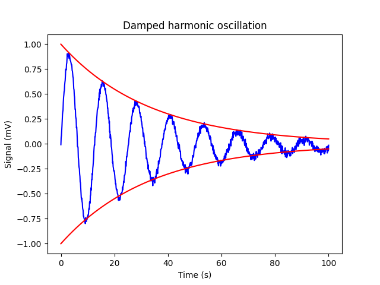

[np.loadtxt]: <https://numpy.org/doc/stable/reference/generated/numpy.loadtxt.html> "np.loadtxt"
[np.mean]: <https://numpy.org/doc/stable/reference/generated/numpy.mean.html> "np.mean"
[matplotlib.pyplot]: <https://matplotlib.org/3.5.3/api/_as_gen/matplotlib.pyplot.html> "matplotlib.pyplot"
[np.exp]: <https://numpy.org/doc/stable/reference/generated/numpy.exp.html> "np.exp"

# Laborübung 2

## Einleitung

In der folgenden Aufgabe sollst du die Messdaten einer Messung am Oszilloskop auslesen und graphisch darstellen. Aufgaben wie diese werden dir später in Laborübungen häufig begegnen.

## Aufgabe

1. Lies die Daten einer Messung am Oszilloskop aus dem File `oscillation.dat` mithilfe von [np.loadtxt] ein. Setze dabei den Datentyp auf `np.float64`. Die Daten sind folgendermaßen zu interpretieren:

   | Linke Spalte     | Rechte Spalte    |
   |------------------|------------------|
   | Zeit in Sekunden | Messsignal in mV |

2. Schau dir die Daten an, indem du sie mithilfe von [matplotlib.pyplot] plottest. Verwende für die Daten eine durchgezogene blaue Linie.

3. In den Daten scheint es einen Offset zu geben (Null-Auslenkung der Schwingung nicht auf der x-Achse). Kalibriere das Signal, sodass die Null-Auslenkung beim Plotten auf der x-Achse liegt (das heißt bei y = 0).

4. Es handelt sich offenbar um eine gedämpfte harmonische Schwingung, deren Amplitude von 1 exponentiell abfällt. Verwende [np.exp], um die beiden einhüllenden exponentiellen Funktionen der Amplitude zu plotten. Verwende eine durchgezogene rote Linie und setze dabei die Dämpfungskonstante auf $\delta = 0.03$.

5. Beschrifte die x-Achse mit `Time (s)` und die y-Achse mit `Signal (mV)`. Gib deiner Graphik den Titel `Damped harmonic oscillation`.

## Hinweise

* Vergiss beim Laden der Daten nicht, auf den Datentyp (`np.float64`) und die Kommentare (`comments='%'`) zu achten!

* Um den Offset von den Daten abzuziehen, verwende [np.mean].

* Weitere Informationen zum Plotten von Daten findest du in der  [matplotlib.pyplot]-Dokumentation.

* Achtung! Achte auf die Reihenfolge der Plots. Achte darauf, die Einhüllende als Zweites zu plotten! Die obere einhüllende Kurve der exponentiellen Abnahme muss zuerst geplottet werden, da der Test dies sonst als Fehler erkennt.

* Am Ende sollte dein Plot so aussehen:

## Keywords

- Datenverarbeitung
- Plotten