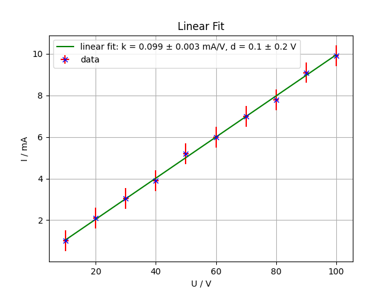

[np.polyfit]: <https://numpy.org/doc/stable/reference/generated/numpy.polyfit.html>
[plt.errorbar]: <https://matplotlib.org/stable/api/_as_gen/matplotlib.pyplot.errorbar.html>
[Wahrscheinlichkeitstheorie]: <http://itp.tugraz.at/LV/wvl/Statistik/A_WS_pdf.pdf>

# Laborübung 3

## Einleitung

Diese Übung soll eine Einführung in das Fitten und Plotten von mit Unsicherheit behafteten Daten sein.
Als Daten stehen in dieser Übung Strom- und Spannungsmessungen zur Verfügung, welche im File `data_lab3.dat` abgespeichert
sind. Die erste Spalte enthält die Spannungswerte, die zweite die Stromwerte.

Einfache Fits von Polynomfunktionen können in Python mithilfe der `numpy`-Funktion [np.polyfit] durchgeführt werden.
Die Funktion verwendet ein sogenanntes *linear least squares*-Verfahren, bei dem die Parameter der Polynomfunktion so
berechnet werden, dass sie die Daten am besten beschreiben. Die Funktion ist für ein Polynom von Grad `n` dabei so anzuwenden:

```python
popt, pcov = np.polyfit(xdata, ydata, deg=n, cov=True)
```

`popt` sind hierbei die optimierten Parameter und `pcov` ist die sogenannte Kovarianzmatrix. Die Wurzeln der Diagonalelemente der Matrix sind dabei die Standardabweichung der ermittelten Parameter
(für Details siehe Skript [Wahrscheinlichkeitstheorie]). Die gefitteten Funktionen lassen sich dann mit den Unsicherheiten als Fehlerbalken mithilfe von [plt.errorbar] plotten (siehe Dokumentation).

## Aufgabe

Schreib ein Skript `lab_exercise3.py`, in dem du die Daten des Laborversuchs auswertest:

1. Lade die Daten aus `data_lab3.dat` und speichere die Spalten in dafür geeigneten Vektoren. Achte darauf, dass im ganzen Programm nur mit **Milliampere** und nicht mit Ampere gerechnet wird.

2. Erstelle zwei Vektoren der richtigen Länge, die mit der Unsicherheit der Messungen gefüllt sind. Die Unsicherheit der Strommessung beträgt 0,5 mA, die der Spannungsmessung 1 V.

3. Fitte die Daten mit einer Geraden (Polynom erster Ordnung). Verwende dazu den Befehl [np.polyfit].

4. Speichere die Fit-Parameter in den Variablen `slope` und `offset`.

5. Speichere die Unsicherheit der Fit-Parameter in den Variablen `delta_slope` und `delta_offset` für ein 95%-Konfidenzintervall (2 Sigma).

6. Erstelle einen Vektor `U_fit` mit 100 Werten zwischen dem kleinsten und größten Spannungswert.

7. Erstelle einen Vektor `I_fit`, in welchem mittels `U_fit`, der Steigung `slope` und der Nullpunktsverschiebung `offset` die Stromwerte der Geraden berechnet werden.

8. Erzeuge eine Grafik und plotte mit [plt.errorbar] die Stromwerte in mA auf der y-Achse gegen die Spannungswerte in V auf der x-Achse mit ihren jeweiligen Unsicherheiten aus Punkt 2.
    * Verwende als Linienfarbe für die Fehlerbalken Rot.
    * Für die Marker verwendest du blaue `x`.
    * Verbinde die Datenpunkte **nicht**.

9. Plotte die Gerade (`I_fit` gegen `U_fit`) als durchgezogene Linie in grün.

10. Gib der Grafik den Titel *Linear Fit* und beschrifte die Achsen wie in **Laboruebung 1** gelernt.

11. Erstelle eine Legende für die Plots.
    Gib dafür jeder Linie ein `label`-Attribut mit dem jeweiligen Text. Anschließend zeigst du die Legende an mit

    ```python
    plt.legend()
    ```

    Der Text für das Label für den Fit soll in einer von dir zu erstellenden Variable definiert werden:

    ```
    linear fit: k = `slope` ± `delta_slope` mA/V, d = `offset` ± `delta_offset` V
    ```

    Die Variablen sind dabei wie im vorangegangenen Beispiel mit f-Strings einzusetzen. Die Anzahl an Nachkommastellen soll dabei so gewählt werden, dass die Unsicherheit genau einen Zahlenwert ungleich 0 besitzt. Auf diese Anzahl an Nachkommastellen ist auch der zugehörige Parameter zu setzen. Die Ermittlung der Anzahl an Stellen kann händisch erfolgen, es benötigt dazu kein Programm!

## Hinweise

* Achte auf die kommentierte erste Zeile des Datenfiles!

* Um das 95%-Konfidenzintervall mit 2 Sigma zu erhalten, multiplizierst du die Unsicherheit der Fit-Parameter mit 2

* Beim Plotten mit [plt.errorbar] kannst du mit den *keyword arguments* `fmt`, `color` und `ecolor` den Marker sowie die Farben der Datenpunkte und der Fehlerbalken einstellen. Mit `capsize` modifizierst du die Größe der Fehlerbalken.

* Um das Zeichen ± zu erhalten, kopiere es einfach aus der Angabe oder nutze den LaTeX-Mathemodus mit `$\pm$`.

* Wenn du alles richtig gemacht hast, sollte deine Grafik so aussehen:

<div align="center">

</div>
