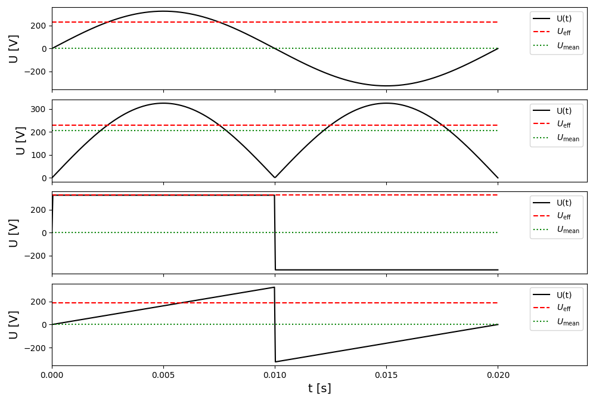

[np.mod]: <https://numpy.org/doc/stable/reference/generated/numpy.mod.html> "np.mod"
[np.sign]: <https://numpy.org/doc/stable/reference/generated/numpy.sign.html> "np.sign"

# Lambda-Funktionen

## Einleitung

Python-Lambda-Funktionen sind eine elegante Möglichkeit, anonyme Funktionen zu erstellen. Im Gegensatz zu benannten Funktionen (def ...) können Lambda-Funktionen in Python ohne eine separate Definition definiert werden. Sie werden häufig in Situationen verwendet, in denen eine kurzlebige Funktion benötigt wird, wie beispielsweise beim Sortieren von Listen oder beim Definieren von Funktionen, die als Argumente an andere Funktionen übergeben werden. Man schreibt sie

```python
make_double = lambda x: 2*x
a = make_double(5)
```


## Aufgaben
Erledige folgende Aufgaben:

1. Schreib eine Lambda-Funktion `adder`, die die Summe von zwei Zahlen berechnet.

2. Initialisiere `data = [(2, 3), (12, 3), (-4, 5), (6, -7), (8, 9), (-3, 11)]`, eine Liste mit $x$- und $y$-Werten als tuples. Nutze Lambda-Funktionen als `key`-Input für den Befehl `sorted`, um die Liste einmal nach dem $y$-Wert zu sortieren und einmal nach dem Abstand zum Ursprung. Speichere die sortierten Listen als `sorted_y` bzw. `sorted_r` ab.

3. Initialisiere `l = [7, 2, 3, 12, 6, 13, 4]` und nutze `list` und `filter` zusammen mit einer Lambda-Funktion, um die Liste `evens` zu generieren, die nur gerade Zahlen enthält. Der Befehl `list(filter(lambda x: x >= 7, l))` zum Beispiel generiert eine Liste mit allen Werten, die größer oder gleich $7$ sind.


4. Erstelle die benannte Funktion `calc_multiple(n)`, die eine Lambda-Funktion zurückgibt. Diese Lambda-Funktion multipliziert ihr eigenes Argument mit dem Wert `n`, der beim Aufruf von `calc_multiple` übergeben wird. In diesem Beispiel sollte $12$ ausgegeben werden:

    ```python
    doubler = calc_multiple(2)
    print(doubler(6))
    ```


Nun nutzen wir Lambda-Funktionen, um den [arithmetischen Mittelwert](http://de.wikipedia.org/wiki/Arithmetisches_Mittel)

$$\bar{U}(t) = \frac{1}{T}\int_0^T U(t) dt$$

und den [Effektivwert](http://de.wikipedia.org/wiki/Effektivwert) 

$$U_{\mathrm{eff}}(t) = \sqrt{\frac{1}{T}\int_0^T U(t)^2 dt}$$

eines periodischen Signals zu untersuchen.


1. Speichere in der Variablen `U_0` die Amplitudenspannung $U_0 = 230\sqrt{2}$ und in `f` die Frequenz $f=50$.

2. Berechne aus der Frequenz die Periodendauer in der Variable `T`.

3. Erzeuge einen Vektor `t` mit `500` äquidistanten Werten von `0` bis `T`. 

4. Aus `U_0`, `f` und `T` werden nun vier verschiedene Signalformen erzeugt. Erstelle dazu die folgenden Lambda-Funktionen:
    * `f_sin(t)` Sinusförmiges Signal mit Amplitude `U_0` und Frequenz `f`
       
    * `f_abssin(t)` Wie `f_sin(t)`, allerdings soll das Signal immer positiv sein
       
    * `f_square(t)` Rechtecksignal mit der Amplitude `U_0` und der Frequenz `f` (siehe Hinweis).
       
    * `f_saw(t)` Sägezahnsignal von $-U_0$ bis $+U_0$ mit der Steigung $k=4fU_0$ (siehe Hinweis).

    Vergiss nicht, dass du deine Funktionen mittels Graphiken testen kannst.

5. Verwende nun eine Schleife, um über alle Funktionen zu iterieren und dabei die Arrays `U_mean` bzw. `U_eff` aufzufüllen. Verwende für die Integrale [integrate.simpson](https://docs.scipy.org/doc/scipy/reference/generated/scipy.integrate.simpson.html) von scipy.


6. Stelle in der gleichen Schleife die vier Signale in Subplots untereinander mit gemeinsamer $x$-Achse dar. Zeichne den Mittelwert und den Effektivwert als horizontale Linien ein.


7. Beschrifte die Achsen und erstelle Legenden. 


## Hinweise
* Für das Rechtecksignal benutzt du den Befehl [np.sign].

* Für das Sägezahnsignal benutzt du den Befehl [np.mod].

* Das Ergebnis sollte so ausschauen:

<div align="center">

</div>