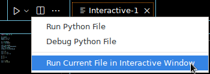

# Mathematische Konstanten

Dies ist die erste Aufgabe. Du löst diese Aufgabe im Editor, indem du dort
alle Variablen definierst, die unten in der Tabelle angegeben sind.

- Du kannst dein Programm jederzeit ausführen, indem du *Run Current File in Interactive
  Window* auswählst. In dieser Ansicht, in der weiteren Beschreibung Konsole genannt,
  siehst du die Ausgabe deines Programms und eine Eingabezeile.

<div align="center">

</div>

- Mit „Pfeil nach oben“ kannst du in der Konsole zu vorherigen Befehlen zurückkehren
  und diese ausführen. Du kannst in der Konsole Namen von Variablen eingeben und siehst
  dann das Ergebnis.

- Die Tastenkombination `Shift-Enter` führt nur den markierten Bereich im Editor aus.

- Lies unbedingt die Einleitung sowie die weiter unten stehenden Hinweise! Diese
  helfen, alles richtig zu machen.

## Einleitung

In dieser Aufgabe wird das Modul NumPy vorgestellt, und zur Definition erster Variablen
verwendet.

### NumPy

Python bietet mit dem [Modul] NumPy Funktionen für numerische Berechnungen.
Wie in der [NumPy-Dokumentation] verwenden wir dafür das Kürzel `np`:

```python
import numpy as np
```

Damit lässt sich beispielsweise der Sinus von 1 folgendermaßen berechnen:

```python
np.sin(1.0)  # Ausgabe: 0.8414709848078965
```

### Exponentialfunktion

Die Zahl $\mathrm{e}$ als solche existiert in Python nicht. Sie muss mit Hilfe der
Funktion [exp] konstruiert werden. Will man $\mathrm{e}^x$ berechnen, verwendet man
nicht `e**x`, sondern `np.exp(x)`. Auch wenn `e` wie in diesem Beispiel schon definiert
ist, schreibt man nicht `e**2`, sondern `np.exp(2)` für $e^2$.

### Bereits vorhandene Variablen

Wenn man für eine bestimmte Größe bereits eine Variable definiert hat, dann soll man diese wieder verwenden. Hier in unserem Beispiel ist z.B. `two_p` bereits bekannt, man
schreibt also dann bei der Berechnung von $\sin 2\pi$ nicht `np.sin(2 * np.pi)`, sondern
`np.sin(two_p)`.

### Ausgabe am Schirm

Führe dein Skript in der Python-Konsole aus und sieh dir dort den Wert der von dir definierten Variablen an, gib also z.B. `e` ein.

Als Resultat wirst du $2.718281828459045$ sehen. Dies ist die vollständige Darstellung
der Zahl $e$ in der Numerik. Natürlich ist $e$ eine reelle Zahl mit unendlich vielen
Stellen hinter dem Komma, aber in der numerischen Berechnung muss man sich mit einer
beschränkten Anzahl begnügen. Diese ist durch die Festlegung der Größe des
Speicherplatzes definiert. Beim Standard-Datentyp [double] sind das insgesamt $16$
Stellen. Nicht signifikante Nullen nach dem Komma werden in dieser Darstellung nicht
angezeigt.

### Genauigkeit

Wenn du dir verschiedene Resultate für den Sinus ansiehst, wirst du feststellen, dass
du für $\sin 0$ und $\sin \pi/2$ die erwarteten Resultate siehst. Für $\sin 2\pi$
bekommst du nicht Null, sondern `-2.4492935982947064e-16`
als Resultat.
Das bedeutet in mathematischer Notation
$-2.4492935982947064\cdot 10^{-16}$, was zwar eine sehr kleine Zahl, aber nicht
exakt Null ist. Dieser kleine numerische Fehler ist das Resultat des limitierten
Speicherplatzes für Variablen. Analog zu den Resultaten für den Sinus wirst du auch
Unterschiede zwischen `np.exp(2)` und `e**2` erkennen.

### Imaginäre Einheit

Eine weitere Konstante ist die imaginäre Einheit $j=\sqrt{-1}$, diese ist in Python
definiert. Bei ihrer Verwendung muss man aber unbedingt `1j` und nicht etwa `1*j` oder
`j` schreiben, da der Variable `j` auch ein anderer Wert zugewiesen sein kann. Deine
Resultate sind nur richtig, wenn du die korrekte Schreibweise `1j` verwendest.

### Eingabe von Zahlen mit Mantisse und Exponent

Die Darstellung einer sogenannten [Gleitkommazahl] besteht aus einer Mantisse
($-2.4492935982947064$), einer Basis ($10$) und dem Exponenten ($-16$).

Man kann Variablen auch mit diesem Zahlenformat definieren, z.B., `1.5e5`, `7.35e-15`

### Variablennamen

Für das automatische Testen ist es unbedingt notwendig, dass du
**<span style="color: red;">die angegebenen Namen</span>** für deine Variablen verwendest!
Bei den verwendeten Namen siehst du, dass als einzig erlaubtes Sonderzeichen der
Unterstrich (underscore) `_` verwendet wird. Namen von Variablen bestehen aus
Buchstaben, Zahlen und `_` und dürfen nicht mit Zahlen beginnen. Daher sind die
Bezeichnungen `2p` oder `2_p` für $\sin 2\pi$ nicht erlaubt.

## Aufgabe

Führe im Python-Skript `mathc` (File: `mathc.py`) einige einfache Definitionen von
Variablen durch. Lies die jeweiligen Hinweise und probiere das Programm aus,
bevor du es „abgibst“.

1. Starte mit dem Import des Modules `numpy`.

1. Definiere die folgenden Variablen.

$$
\begin{aligned}
\texttt{p}        & = \pi \\
\texttt{p\_half}   & = \pi/2 \\
\texttt{two\_p}    & = 2\pi \\
\\
\texttt{e}        & = \mathrm{e} \quad \text{(Eulersche Zahl)} \\
\texttt{e\_2}      & = \mathrm{e}^2 \\
\\
\texttt{s\_0}      & = \sin 0 \\
\texttt{s\_p\_half} & = \sin \pi/2 \\
\texttt{s\_p}      & = \sin \pi \\
\texttt{s\_two\_p}  & = \sin 2\pi \\
\\
\texttt{i\_1}      & = 2j \quad \text{(siehe Einleitung)} \\
\texttt{c\_1}      & = 3 + 4j \\
\texttt{c\_2}      & = 1 + j\pi \\
\\
\texttt{a}        & = 5 \\
\texttt{b}        & = 3 a \\
\texttt{a}        & = 7 \\
\\
\texttt{v\_1}      & = 1.5\cdot 10^{6} \quad \text{(Mantisse und Exponent, siehe Einleitung)} \\
\texttt{v\_2}      & = -3.7\cdot 10^{-10} \\
\end{aligned}
$$

3. Überleg dir bei den Variablen `a` und `b`, welche Werte diese am Ende des Programms
   haben und warum das so ist. Stichwort: wiederholte Zuweisungen

## Hinweise:

- Python-Hilfe zu einzelnen Befehlen findest du unter [exp] und [sin].

- Best practice: Verwende wie in der Angabe beschrieben `np.exp(1)` anstatt `np.e`
  für die Euler'sche Zahl `e`. Bei Verwendung von `np.e` wird im Test eine
  Fehlermeldung ausgegeben. Dies liegt daran, dass `np.exp(1)` und `np.e` verschiedene
  Datentypen haben. NumPy verwendet eigene Datentypen wie `numpy.float64`, um die
  Konsistenz in numerischen Berechnungen zu gewährleisten. Mit `np.exp(1)` ist der Wert
  kompatibel mit NumPy-Arrays, Funktionen und weiteren Bibliotheken.

- Weiters wird bei `np.exp(2)` der Funktionswert der Exponentialfunktion an der Stelle 2
  ausgewertet, während `np.e**2` bloß den Wert für `e` quadriert. Durch Rundungsfehler
  ergibt dies leichte Unterschiede im Ergebnis.

- Die Operatoren `+`, `-`, `*`, `/` und `**` bezeichnet man als
  [arithmetische Operatoren].

- Eine sehr praktische Form der Hilfe bekommt man in der Konsole. Man kann z.B. die Python-Hilfe für $\sin$ einfach durch `help(np.sin)` aufrufen.

[arithmetische operatoren]: https://docs.python.org/3/library/stdtypes.html#numeric-types-int-float-complex "arithmetische Operatoren"
[double]: https://numpy.org/doc/stable/user/basics.types.html "double"
[NumPy-Dokumentation]: https://numpy.org/doc/stable/index.html "NumPy-Dokumentation"
[exp]: https://numpy.org/doc/stable/reference/generated/numpy.exp.html "exp"
[gleitkommazahl]: https://de.wikipedia.org/wiki/Gleitkommazahl "Gleitkommazahl"
[modul]: https://docs.python.org/3/tutorial/modules.html "Modul"
[sin]: https://numpy.org/doc/stable/reference/generated/numpy.sin.html "sin"


## Keywords

- Variablennamen
- NumPy
- Imaginäre Einheit