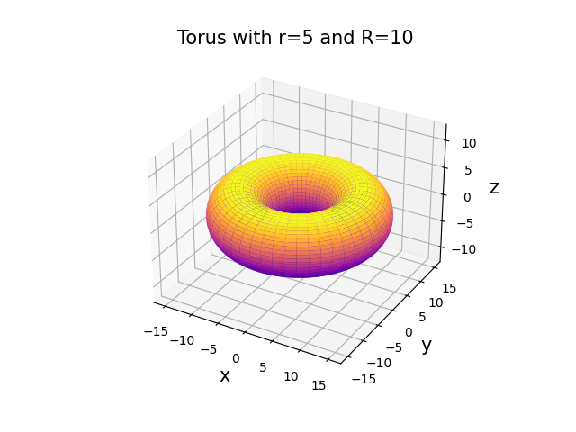

[meshgrid]: <https://numpy.org/doc/stable/reference/generated/numpy.meshgrid.html> "meshgrid"
[3D surface]: <https://matplotlib.org/stable/gallery/mplot3d/surface3d.html> "3D surface"

# Plot eines kreisförmigen Torus

## Einleitung

### Mathematische Grundlagen
Die Oberfläche eines [Torus](http://de.wikipedia.org/wiki/Torus) ist definiert durch:
$$
\begin{aligned}
  x & =  [ R + r \cdot \cos(\theta) ] \cos(\phi) \\
  y & =  [ R + r \cdot \cos(\theta) ] \sin(\phi) \\
  z & =  r \cdot \sin(\theta)
\end{aligned}
$$

mit den folgenden Toruskoordinaten:

* $\phi$: der toroidale Winkel mit $\phi \in [0, 2 \pi]$; er entspricht `t` auf Wikipedia.

* $\theta$: der poloidale Winkel mit $\theta \in [0, 2 \pi]$; er entspricht `p` auf Wikipedia.

* $R$: der Hauptradius, sprich der Abstand vom Mittelpunkt bis zum Mittelpunkt der Röhre.

* $r$: der Nebenradius, sprich der Radius der Röhre.

## Aufgabe

Schreib nun das Skript `torus`, in dem du einen Torus darstellst. 

1. Für die Berechnung der Toruskoordinaten schreibst du eine Funktion `torus_coor(phi, theta, r, R)`, die die eindimensionalen Winkel und skalaren Radien als Input nimmt und die zweidimensionalen ([meshgrid]) Koordinaten `x`, `y` und `z` zurückgibt.

2. Plotte anschließend die Oberfläche des Torus in einem 3D-Plot, wobei du die Stützstellen frei wählen kannst, sowie die Details der Darstellung im Plot. Die Beschriftung sollte allerdings sinnvoll sein.

3. Achte darauf, dass die Achsen gleich skaliert sind.

4. Zum Schluss speicherst du das Bild als `.png`-Datei ab.

## Hinweise
* [meshgrid]
* [3D surface]
* [Color maps](https://matplotlib.org/stable/users/explain/colors/colormaps.html)

