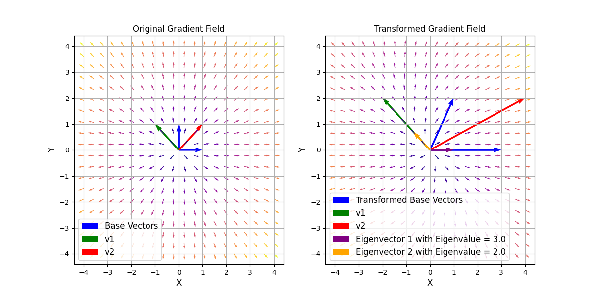

# Vektorfelder und Eigenvektoren

## Einleitung
In diesem Beispiel werden Vektorfelder und Eigenvektoren visualisiert, um ein grundlegendes Verständnis für ihre Bedeutung und Anwendung zu vermitteln. Eigenvektoren und Eigenwerte sind zentrale Konzepte in der linearen Algebra, die in verschiedenen Anwendungen wie der Analyse von linearen Transformationen und der Lösung von Differentialgleichungen eine wichtige Rolle spielen.

Eigenvektoren sind spezielle Vektoren, die unter ihrer korrespondierenden linearen Transformation ihre Richtung nicht ändern, sondern nur skaliert werden. Die zugehörigen Eigenwerte geben an, um welchen Faktor die Eigenvektoren skaliert werden.
Sie sind Lösungen der Gleichung:
$$
\hat{A}\vec{x} = \lambda \vec{x},
$$

wobei $\hat{A}$ die Transformationsmatrix, $\vec{x}$ der Eigenvektor und $\lambda$ der Eigenwert ist.

Diese Gleichung kann durch:
$$
\det(\hat{A} - \lambda \hat{I})\vec{x} = 0
$$
gelöst werden, wobei $\hat{I}$ die Einheitsmatrix ist.

Dieses Beispiel sollte das Konzept der Eigenvektoren und Eigenwerte anschaulich machen. Zusätzlich erhältst du einen Einblick in die Visualisierung von Vektorfeldern.


## Aufgabe

1. Erzeuge mittels des Befehls `np.meshgrid` ein Gitter von $x$- und $y$-Werten. Du kannst die Start- und Endwerte für $x$ und $y$ frei wählen. Das Gitter sollte $N \times N$ Punkte haben. Wähle $N$ zu Beginn klein, z.B. $N=10$.

2. Berechne mittels der Funktion `gradient_field` das Gradientenfeld für das Skalarfeld $V(r) = r^2$.


3. Plotte das Gradientenfeld mit Hilfe von [quiver](https://matplotlib.org/stable/api/_as_gen/matplotlib.pyplot.quiver.html) in einem Subplot. Hier bietet es sich an, die Vektoren zu normalisieren, damit die Vektoren nicht zu groß werden. Die Größe der Änderung des Skalarfeldes kannst du farblich darstellen.

4. Plotte die Basisvektoren und die Vektoren `v1` und `v2`, wobei

  ```math
  \vec{v}_1 = \begin{bmatrix}
  -1 \\ 1
  \end{bmatrix}
  ```

  ```math
  \vec{v}_2 = \begin{bmatrix}
  1 \\ 1
  \end{bmatrix}.
  ```

5. Führe eine lineare Transformation des Gradientenfeldes durch. Dabei soll die Transformationsmatrix `transformation_matrix` gleich

  ```math
  \hat{A} = \begin{bmatrix}
  3 & 1 \\
  0 & 2
  \end{bmatrix}
  ```

  sein.

6. Plotte das transformierte Gradientenfeld in einem Subplot neben dem ursprünglichen Gradientenfeld. Dieses sollte auch normiert sein und die Farbe sollte die Größe der Änderung des Skalarfeldes darstellen.

7. Plotte zusätzlich die transformierten Basisvektoren und `v1_trans` und `v2_trans`.

8. Stelle die Eigenvektoren der Transformationsmatrix $\hat{A}$ im Plot dar.

9. Wähle eine andere Transformationsmatrix und beobachte, was passiert.
  Warum kann die Transformation

  ```math
  \hat{A} =\begin{bmatrix}
  1 & -1 \\
  1 & 1
  \end{bmatrix}
  ```

  nicht dargestellt werden?

<dev align="center">
  
</dev>

## Hinweise

* Für die lineare Transformation kannst du den `@` Operator oder `np.matmul` verwenden.

* Die Befehle `np.vstack` und `np.ravel` könnten hilfreich sein.

* Für die Normierung kannst du entweder die Funktion `np.linalg.norm` oder die Funktion `np.sqrt` verwenden.

* Für dieses Beispiel gibt es beschränkte Tests. Überprüfe daher anhand der Abbildung, ob deine Lösung korrekt ist.
