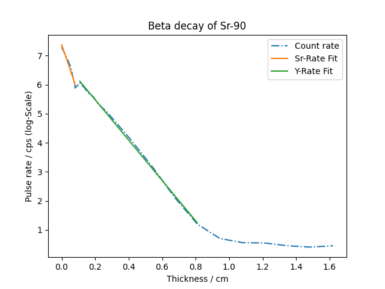

[Massenabsorptionskoeffizient]: <https://de.wikipedia.org/wiki/Massenschw%C3%A4chungskoeffizient>

# Beta-Absorption

Dieses Beispiel soll dir eine Zusammenfassung über die Themen der ersten 3 Wochen dieser Übung geben.
Wenn möglich, solltest du die Aufgabe ohne Hinweise und Hilfe der TutorInnen lösen können. Wenn du nach
mehreren Versuchen nicht weiterkommen solltest, helfen wir dir gerne.

## Einleitung

In einem Laborversuch wird der radioaktive Zerfall einer Probe mit einem Geiger-Müller-Zählrohr gemessen.
Es handelt sich dabei um Strontium-90 (Sr-90), einen $\beta$-Strahler, der in Y-90 zerfällt. Y-90 ist dabei selbst noch
ein instabiler Kern, der sich in einem weiteren $\beta$-Zerfall mit einer anderen Halbwertszeit in Zr-90 umwandelt.

$$
    {}^{90}_{38}Sr \rightarrow {}^{90}_{39}Y \rightarrow {}^{90}_{40}Zr
$$

Wenn radioaktive Strahlung durch ein Material abgeschirmt werden soll, dann spielen für die Effizienz der Abschirmung
sowohl die Art des Materials (Element) als auch die Dicke des Materials eine Rolle. Das *[Lambert-Beer'sche Gesetz]*
beschreibt dabei, wie sich die Intensität einer Strahlung beim Durchgang durch ein Material in Abhängigkeit von der Dicke des Materials ändert.

$$
    I(d) = I_0 \cdot e^{-\mu \cdot d}
$$

Dabei ist $I_0$ die ursprüngliche Intensität, $d$ die Schichtdicke und $\mu$ der Absorptionskoeffizient des Materials.
Trägt man die Impulsrate logarithmisch gegenüber der Schichtdicke auf, erhält man eine Absorptionskurve:

$$
    \ln I = -\frac{\mu}{\rho} \cdot (\rho \cdot d) + \ln I_0
$$

Die Steigung der logarithmierten Impulsrate $\mu / \rho$ ist dabei der sogenannte *[Massenabsorptionskoeffizient]*, ein wichtiger Parameter in der Strahlenphysik
($\rho$ ist die Dichte des Materials).

## Aufgabe

In der folgenden Aufgabe sollen die Massenabsorptionskoeffizienten von Yttrium und Zirkonium beim Durchgang durch Aluminium bestimmt werden.

1. Im File `beta_absorption.csv` wurde für verschiedene Schichtdicken einer Aluminium-Platte die Messdauer sowie die Anzahl der Impulse im Geiger-Müller-Zähler gespeichert.
   * Spalte 1: Dicke (mm)
   * Spalte 2: Messdauer (min)
   * Spalte 3: Anzahl Impulse
   Lies das File mit `np.loadtxt` ein und speichere die jeweiligen Schichtdicken, Messdauern und Impulse als NumPy-Arrays mit den Variablennamen `thickness`, `t` und `N`.

2. Berechne die Zählraten aus `N` und `t` in counts per second (cps) und speichere sie im Array `I`. Beachte dabei, dass die Zeiteinheit im Datenfile **Minuten** sind.
3. Logarithmiere die Zählraten.
4. Um die Formel mit der logarithmierten Zählrate fitten zu können, musst du das Array `thickness` noch mit der Dichte von Aluminium multiplizieren. Nimm hierfür eine Dichte von $\rho$ = 2.70 g/cm³ an (achte auf die richtige Einheitenumwandlung!)
5. Plotte die logarithmierten Zählraten in Abhängigkeit von $\rho\cdot d$. Verwende eine strichpunktierte Linie und gib den Daten das Label `Count rate`.
6. Beschrifte die x-Achse mit `Thickness / cm` und die y-Achse mit `Pulse rate / cps (log-Scale)`. Gib der Graphik den Titel `Beta decay of Sr-90`.
7. Im Plot wird dir auffallen, dass die Datenkurve an einer bestimmten Stelle einen Knick aufweist. Dies ist jener Punkt, an dem die maximale Reichweite der Sr-90-Strahlung erreicht ist und nur noch die höherenergetische Y-90-Strahlung das Material durchdringen kann. Identifiziere die Position des Knicks anhand der Datenpunkte.
8. Um die Massenabsorptionskoeffizienten von jeweils Sr-90 und Y-90 in Aluminium bestimmen zu können, musst du nun links und rechts des Knicks 2 lineare Fits durchführen. Geh folgendermaßen vor:
    * Erstelle mittels Indizierung zwei Arrays `Sr_rate` und `thickness_Sr` für den Bereich links des Knicks sowie `Y_rate` und `thickness_Y` für den Bereich rechts.
    * Führe mithilfe von `np.polyfit` einen linearen Fit durch, um die Steigung der Funktion zu bestimmen.
    * Plotte die 2 gefitteten Funktionen mit den ermittelten Steigungen und y-Achsenabschnitten zusammen mit den Daten in eine Graphik.
    * Im ersten Teil der Zählrate sind Sr-90-Strahlung und Y-90-Strahlung überlagert. Daher musst du für den Absorptionskoeffizienten von Sr-90 noch die beiden Steigungen voneinander abziehen. Verändere die Steigung im plot nicht.
    * Gib den beiden Fits die Label `Y-Rate Fit` und `Sr-Rate Fit`.
9. Zum Schluss sollst du einen `f-string` ausgeben, der die ermittelten Koeffizienten zusammen mit ihren Unsicherheiten angibt. Als Unsicherheiten nimmst du die Wurzeln der ersten Einträge der Kovarianzmatrix aus `np.polyfit` an. Die Ausgabe sollte so aussehen:

```python
Mass absorption coefficient Strontium-90: (9.97 +/- 2.49) cm^2/g
Mass absorption coefficient Yttrium-90: (6.94 +/- 0.08) cm^2/g
```

## Hinweise

* Damit bei `np.polyfit` die Kovarianzmatrix ausgegeben wird, musst du im Funktionsaufruf `cov=True` setzen.

* Achte bei der Schichtdicke auf die korrekten Einheiten! Am Ende soll $\mu / \rho$ die Einheit `cm²/g` haben.

* Warum ist die Unsicherheit beim Wert für Sr-90 viel größer als für Y-90? Hast du dafür eine Erklärung?

* Am Ende sollte deine Graphik so aussehen:

<div align="center">

</div>